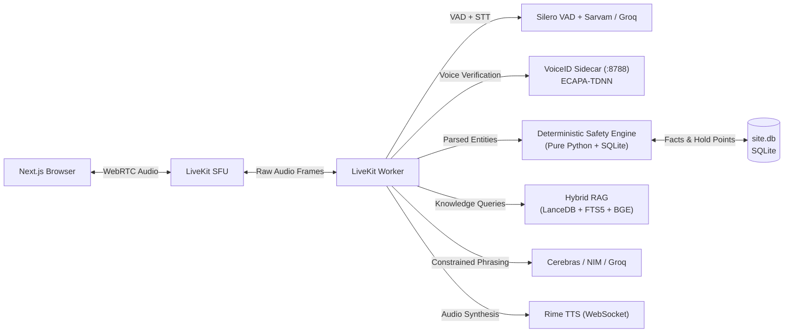
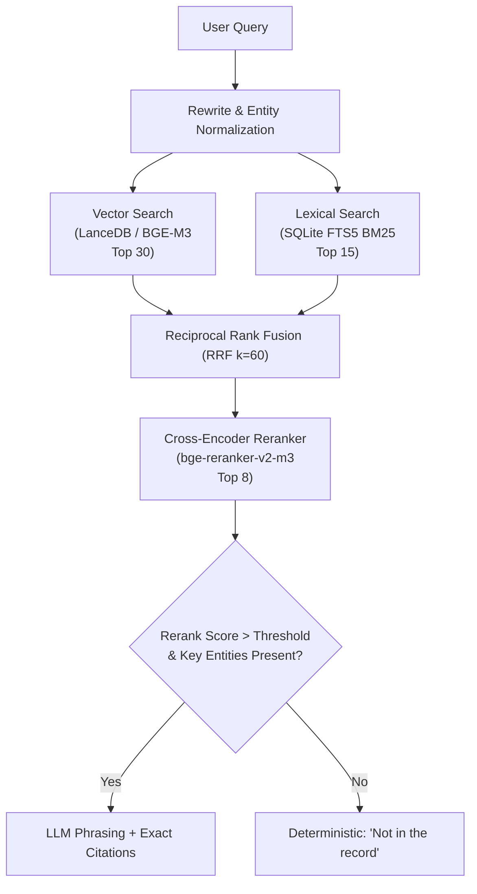

# Vesper.ai — Technical Deep-Dive & Cross-Questioning Defense Guide

This document contains the complete, strictly technical breakdown of **Vesper.ai**, structured specifically for technical defense, viva, architecture reviews, and hackathon judge cross-questioning.

---

## 1. Architectural Thesis & Boundary Separation

The foundational engineering principle of Vesper is: **Voice is an active safety gate, not a transcription box, and the LLM is never trusted with safety decisions.**



### Trust & Process Isolation
1. **Public/Client Boundary:** Next.js frontend (Browser). Holds **only** the Clerk publishable key. Never receives third-party API keys.
2. **Audio Transport Boundary:** LiveKit WebRTC SFU. Handles WebRTC renegotiation, dynamic network jitter, and client microphone streaming.
3. **Voice Biometrics Boundary (`:8788`):** Independent FastAPI microservice running SpeechBrain ECAPA-TDNN locally.
4. **Safety & Operational State Boundary (`site.db`):** Pure Python rule engine executing against SQLite views. **Deterministic, zero-temperature, 0% LLM dependency.**
5. **Knowledge / Memory Boundary (`app.db` & LanceDB):** Hybrid vector + BM25 RAG with strict cross-encoder abstention.
6. **External Provider Boundary:** Groq, Sarvam, Cerebras, NVIDIA NIM, and Rime are contacted exclusively through server-side authenticated calls.

---

## 2. Real-Time Voice Pipeline & Latencies

### A. Audio Ingest & VAD
* **Transport:** WebRTC via LiveKit Cloud / Server.
* **VAD (Voice Activity Detection):** Runs **locally in-process** on the agent worker using **Silero VAD** (`silero-vad` ONNX/PyTorch).
* **Barge-In / Interruption:** When Silero detects speech while TTS is streaming, LiveKit interrupts the outbound audio track in **<150 ms**, halts TTS packet streaming, and flushes audio buffers. Mid-sentence corrections (*"wait, not C-5, C-6"*) discard the superseded utterance.

### B. Speech-to-Text (STT) Chain
* **Primary:** Sarvam `saaras:v3-realtime` WebSocket (optimized for Indian accents, Hindi, and Hinglish).
* **Fallback:** Groq `whisper-large-v3` REST.
* **Domain Normalization (`agent/stt_normalize.py`):**
  * Raw ASR text is regex-normalized to map phonetically garbled Indian construction slang into canonical schema entries:
    * *sariya / saria* $\rightarrow$ `rebar`
    * *tarai / taraai* $\rightarrow$ `curing`
    * *ret / gitti* $\rightarrow$ `sand / aggregate`
    * Alphanumeric grid normalization: transforms *"see five"* or *"c dash five"* $\rightarrow$ `C-5`; *"a one zero two"* $\rightarrow$ `A-102`.
    * Unit conversion: mm, cm, m, inches parsed into standardized SI millimetres.

### C. Text-to-Speech (TTS) Chain
* **Primary:** Rime TTS (`mistv3`, model `wildflower`, English/Indian-accented output) streamed over WebSocket.
* **Fallback:** Sarvam `bulbul:v3`.
* **Speakability Sanitizer (`backend/engine/speech.py`):**
  * All responses pass `engine.speech.speakable()` before reaching TTS:
    * Replaces em-dashes and markdown tables with comma-separated spoken pauses.
    * Converts drawing tags (`A-102@R4`) into phonetic natural speech (*"drawing A 102 revision 4"*).
    * Caps spoken length to short, punchy declarative sentences suitable for noisy job sites.

---

## 3. Speaker Verification: VoiceID Sidecar (`:8788`)

Located in `voiceid/app.py`.

* **Model:** SpeechBrain **ECAPA-TDNN** (`speechbrain/spkrec-ecapa-voxceleb`). Runs locally on CPU/CUDA.
* **Audio Ingestion:** Decoded via FFmpeg subprocess into **16 kHz mono 32-bit float PCM**.
* **Embedding Generation:** Computes a 192-dimensional vector:
  $$\mathbf{e} = \frac{\text{EncoderClassifier}(\mathbf{x})}{\|\text{EncoderClassifier}(\mathbf{x})\|_2}$$
* **Enrollment:** Computes the centroid (mean vector) across $N$ audio sample embeddings, unit-normalized, stored as `<sha256(user_id)[:32]>.npy`.
* **Verification Invariant:**
  * When a state-modifying observation command is spoken, the worker extracts the raw PCM of the **active command utterance**.
  * Computes cosine similarity against the enrolled profile:
    $$\text{score} = \mathbf{e}_{\text{ref}} \cdot \mathbf{e}_{\text{utterance}}$$
  * **Threshold:** $\ge 0.70$.
  * **Fail-Closed Guarantee:** If score $< 0.70$, or if no profile is enrolled, the system enters `clarify` / `refuse` mode. State-mutating tools (`log_observation`, `raise_ncr`, `raise_rfi`) are dynamically unhooked from the LLM tool registry.

---

## 4. The Deterministic Safety Engine

Located in `backend/engine/contradictions.py` and `backend/engine/dialogue.py`.

### How the Engine Evaluates Truth
The engine does **not** ask an LLM *"Does this violate the drawing?"*  
Instead, speech slots are extracted deterministically (`extract.py`), resolved to spatial entities, and queried against SQLite views:

```
Observation (Grid C-5, spacing 180 mm, Level 2)
  ├── 1. Resolve Location -> location_id = LOC_L2_C5
  ├── 2. Fact Lookup -> SELECT value_num, tolerance, revision, code_ref 
                        FROM drawing_facts WHERE location_id='LOC_L2_C5' 
                        AND attribute='rebar_spacing' AND is_latest=1
  └── 3. Rule Evaluation (5 Hardcoded Pure Functions)
```

### The 5 Deterministic Safety Rules
1. **`unknown_drawing`:**  
   The spoken drawing number does not exist in the register, has no *For Construction* revision, or does not govern the queried structural element.
2. **`revision_mismatch`:**  
   The observation quotes or matches a superseded revision (e.g., claiming Rev 3 when Rev 4 is active). Identifies the exact governing RFI (e.g., `via_rfi: RFI-047`).
3. **`dimension_mismatch`:**  
   Evaluated against explicit tolerance:
   $$|\text{Observed} - \text{Expected}| > \text{Tolerance}$$
   Example: Observed cover 25 mm vs. expected $40 \pm 5\text{ mm}$ triggers a violation citing IS 456 Cl. 26.4.2.
4. **`permit_blocker`:**  
   Queries `permits` and `permit_checks`. If an activity (e.g., hot work/welding) is attempted without an active permit or with unfulfilled mandatory safety checks (e.g., fire watch unassigned), the action is blocked out loud.
5. **`hold_point_blocker`:**  
   Checks QA/QC inspection checklists (`checklists`). Pouring concrete without sign-off on pre-pour checklists or rebar clearance triggers a hard hold-point stop.

### Human-in-the-Loop Confirmation
The engine refuses automated writes. When a discrepancy occurs, it prompts a choice: **Raise RFI**, **Raise NCR (Non-Conformance Report)**, **Stop Work**, or **Override/Log**.

---

## 5. Hybrid RAG & Knowledge Memory Architecture

Located in `backend/memory/`.



### Why Hybrid (Dense Vector + Sparse BM25)?
* **Dense Vectors (`bge-m3`, 1024-dim):** Great for semantic matching (*"how do we cure columns in hot weather?"*), but completely fail on alphanumeric tokens (`RFI-047`, `C-5`, `IS 456 Cl. 26.5.3.2`).
* **Sparse FTS5 (BM25):** Matches exact drawing numbers, RFI IDs, and clause numbers with zero vector semantic drift.
* **Fusion:** Reciprocal Rank Fusion (RRF) with constant $k=60$:
  $$\text{RRF\_Score}(d) = \sum_{m \in \{\text{vector}, \text{bm25}\}} \frac{w_m}{60 + \text{rank}_m(d)}$$

### Cross-Encoder & Abstention
* Head of top-ranked candidates is reranked via `bge-reranker-v2-m3` cross-encoder.
* **Strict Abstention Guarantee:**
  * If max cross-encoder score falls below threshold $\mathbf{\tau}$, or
  * If a critical named entity from the query (e.g., specific RFI or Level) is completely absent from the top passages:
  * $\rightarrow$ **The LLM is never invoked.** The system deterministically returns *"That is not in the project record."*
  * Benchmarked: **1.000 recall@8, 1.000 abstain precision, 0% hallucinations.**

### Multi-Tenancy & Data Isolation
* Database tenancy: Clerk Organization ID maps to client company; projects belong to orgs.
* Multi-tenant partition: LanceDB vectors are tagged with dataset IDs: `<org_id>__proj_<project_id>`.
* Invariant: Project isolation is enforced as a **pre-filter inside the LanceDB query execution plan**, not as post-query filtering. Projects only read their own project dataset plus read-only global code libraries (`kb_is_codes`, `kb_templates`, `kb_prices_sor`, `kb_handbook`).

---

## 6. Database Topology & Storage Footprint

| Store | Tech | Contents | Size |
| :--- | :--- | :--- | :--- |
| `data/site.db` | **SQLite (WAL mode)** | Canonical site records: drawings, revisions, facts, RFIs, permits, hold points, locations, observations. | ~15 MB |
| `data/app.db` | **SQLite FTS5** | Application tenancy, documents, text chunks, BM25 indices, job queues. | ~80 MB |
| `data/memory/lancedb` | **LanceDB** | 20,734 embedded chunks ($1024\text{-dim}$ `bge-m3` vectors). | ~395 MB |
| `data/memory/cognee` | **Kuzu Graph DB** | Background-extracted knowledge graph (entities & structural relations). | Variable |
| `Supabase` | **PostgreSQL (pgvector)** | Remote backup mirror of vectors (`vector(1024)`) and `tsvector` FTS index. | Cloud |

---

## 7. Cross-Questioning Defense Guide (Q&A)

### Q1: "Why not just use an end-to-end multimodal model like OpenAI Realtime API or Gemini Live?"
> **Defense:**  
> *"End-to-end multimodal models are probabilistic black boxes. On a construction site, you cannot tolerate an LLM hallucinating whether cover thickness is 25 mm or 40 mm, or deciding if a concrete pour can proceed past an open hold point. In our architecture:  
> 1. Safety decisions are **100% deterministic code** running over SQLite schemas.  
> 2. The LLM only handles conversational phrasing of ground-truth data.  
> 3. We maintain sub-second voice latency while keeping our business logic, speaker biometrics, and site data completely on-premise/local without third-party vendor lock-in."*

---

### Q2: "How do you handle Indian English / Hindi / Hinglish code-switching in noisy site environments?"
> **Defense:**  
> *"We tackle this at three distinct layers:  
> 1. **Acoustic & STT:** We use Sarvam's `saaras:v3`, specifically trained on multilingual Indian accents and code-switching, backed by Silero VAD tuned to reject ambient machinery noise.  
> 2. **Context Normalization (`agent/stt_normalize.py`):** A deterministic regex pre-processor translates phonetic Hindi/Hinglish construction idioms (*sariya*, *tarai*, *gitti*, *daam*) and maps spoken grid references (*'c dash four'*) to schema entities (`C-4`).  
> 3. **Bilingual RAG:** Our knowledge chunks contain bilingual keywords, and BM25 indexing guarantees that queries containing either English or Hindi terms hit the exact same structural clauses."*

---

### Q3: "What prevents a malicious worker from spoofing the site engineer's voice to approve work?"
> **Defense:**  
> *"Two layers of defense:  
> 1. **Per-Utterance ECAPA-TDNN Verification:** We do not verify voice once at login. Every single state-modifying voice command extracts the actual audio utterance and checks its 192-dim embedding against the enrolled centroid at a strict $0.70$ cosine similarity threshold.  
> 2. **Two-Stage Human Decision Gate:** Even when verified, Vesper does not automatically log unverified observations. It forces an explicit verbal confirmation turn ('Confirm log', 'Raise RFI', 'Raise NCR'), locking the transaction to the user's authenticated Clerk identity in the audit trail."*

---

### Q4: "Why did you build hybrid RAG instead of just using vector embeddings?"
> **Defense:**  
> *"Pure vector search fails disastrously in engineering domains. Vector models like `bge-m3` embed semantic meaning, which means they frequently confuse alphanumeric identifiers—treating `RFI-047`, `RFI-050`, or drawing revisions `R3` and `R4` as virtually identical points in vector space.  
> By pairing LanceDB dense vectors with SQLite FTS5 BM25 lexical search using Reciprocal Rank Fusion ($k=60$), BM25 handles exact entity ID lookups while vectors capture conversational semantics. The cross-encoder then reranks only the combined candidate set."*

---

### Q5: "What happens if LiveKit or the Internet drops in the middle of a site inspection?"
> **Defense:**  
> *"The system has a designed **degraded fallback hierarchy** (`ARCHITECTURE.md §3`):  
> 1. If LiveKit WebRTC disconnects, the UI automatically transitions to an asynchronous **MediaRecorder fallback** (`POST /api/stt`).  
> 2. If voice transport completely fails, the **Typed Chat Fallback** (`POST /api/turn`) takes over.  
> 3. Both fallback paths feed into the exact same deterministic safety engine and SQLite database. Crucially: **no offline state allows an unsafe write**. If the engine or biometrics cannot verify the transaction, writes fail closed."*

---

### Q6: "How do you guarantee multi-tenant security when multiple construction firms use the app?"
> **Defense:**  
> *"Tenancy is anchored to Clerk Organization IDs at the JWT verification layer (`backend/tenancy/auth.py`). Every database record and document chunk is tagged with `org_id` and `project_id`. In LanceDB, the dataset filter `<org_id>__proj_<project_id>` is applied as a **pre-filter** inside the native vector scan. Cross-tenant leakage is mathematically impossible at the query planning level, validated by our golden test suite with 0 cross-project leaks."*
